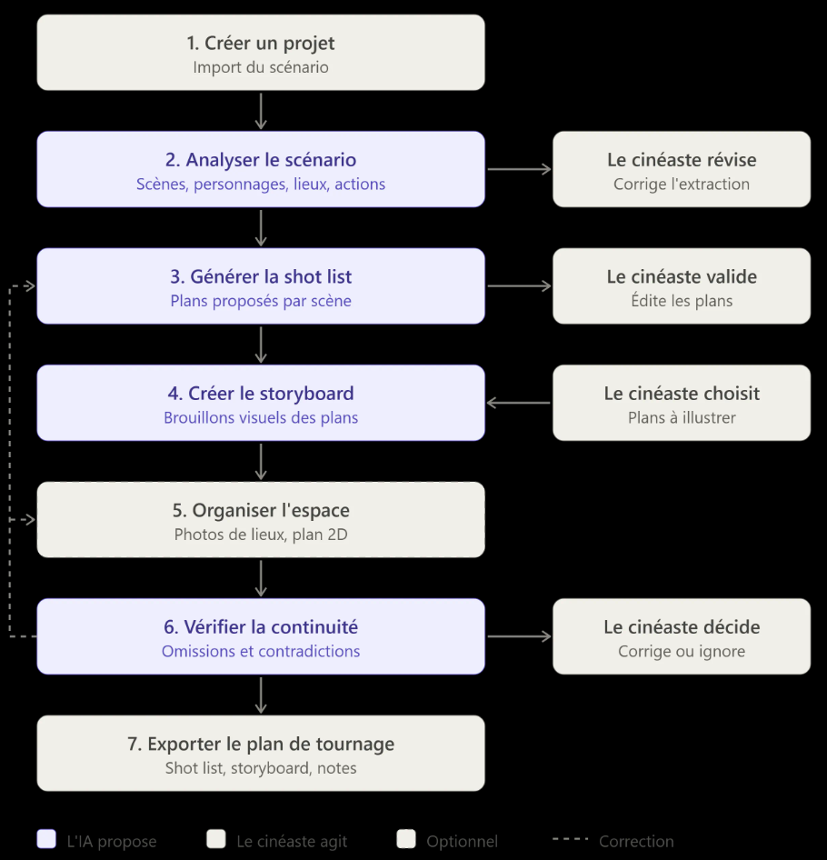

# Scenora

**Du scénario au plan de tournage. L'IA propose, le cinéaste décide.**

Projet présenté au hackathon **IA Éthique 360** (5e édition, JEI et OIF), sous-thématique « L'intégration de l'intelligence artificielle dans l'industrie audiovisuelle à vocation culturelle ».

> **État au 15 novembre 2026 (première soumission) :** le backend FastAPI fonctionne de bout en bout en mode démonstration : création de projet, import et analyse d'un scénario texte, shot list proposée puis éditable, plan 2D et sept règles de continuité dont la règle des 180°. 18 tests passent. Le modèle de langage hébergé, le storyboard, l'interface React et l'export PDF sont prévus. Détail dans [État d'avancement](#12-état-davancement).

## Sommaire

1. [Présentation](#1-présentation)
2. [Le problème](#2-le-problème)
3. [Utilisateurs visés](#3-utilisateurs-visés)
4. [Solution et objectifs](#4-solution-et-objectifs)
5. [Fonctionnalités](#5-fonctionnalités)
6. [Parcours du cinéaste](#6-parcours-du-cinéaste)
7. [Architecture](#7-architecture)
8. [Place de l'IA et approche technique](#8-place-de-lia-et-approche-technique)
9. [Démarche éthique à 360°](#9-démarche-éthique-à-360)
10. [Pile technique et licences](#10-pile-technique-et-licences)
11. [Installation et exécution](#11-installation-et-exécution)
12. [État d'avancement](#12-état-davancement)
13. [Feuille de route](#13-feuille-de-route)
14. [Équipe](#14-équipe)

## 1. Présentation

Scenora transforme un scénario en un plan de tournage organisé et modifiable, qui réunit le découpage, la shot list, le storyboard et l'aide à la continuité.

Au lieu de préparer à la main des documents et des croquis séparés, le cinéaste travaille dans un seul projet relié : scènes, plans, références visuelles et informations de continuité restent cohérents. Modifier un plan met à jour tout ce qui en dépend.

## 2. Le problème

**En une phrase :** les réalisateurs indépendants et les petites équipes de tournage préparent souvent leur découpage, leur shot list et leur storyboard à la main et sans dessinateur, faute de budget et de temps, ce qui entraîne des oublis de plans et des erreurs de continuité découverts sur le plateau ou au montage.

Cette formulation reste une hypothèse de travail : les entretiens avec des réalisateurs tunisiens, prévus avant la demi-finale, la confirmeront ou la corrigeront.

### Ce que montrent les sources

- **La continuité reste le point faible des storyboards générés par IA.** Un directeur artistique d'un studio d'animatiques écrit que chaque image peut être juste seule, mais que positions, regards et échelles dérivent d'un plan à l'autre : « That's where AI still struggles » ([Animatic Media](https://www.animaticmedia.com/the-lab/art-directors-three-more-jobs)). Source professionnelle, issue d'un prestataire du secteur.
- **La recherche va dans le même sens.** Le banc d'essai ViStoryBench (18 méthodes, 80 histoires) montre que cohérence et fidélité aux références s'opposent, et la cohérence des décors sur une scène entière n'y est pas évaluée ([Zhuang et al., arXiv 2505.24862](https://arxiv.org/html/2505.24862v3), prépublication).
- **Les modèles d'image déforment l'Afrique du Nord.** Sur 2 060 images de 206 nationalités, la région MENA figure parmi les plus souvent montrées en « tenue traditionnelle » ([Alsudais, arXiv 2504.06313](https://arxiv.org/abs/2504.06313v3), prépublication).
- **La production tunisienne est fragile.** Le CNCI, créé en 2011, est décrit comme « resté largement inefficace », et une loi de réforme était en commission en avril 2025 ([L'Économiste Maghrébin](https://www.leconomistemaghrebin.com/2025/04/24/nouvelle-loi-pour-relancer-cinema-audiovisuel-tunisiens/)).

### Comment nous l'avons détecté

1. **Recherche documentaire** (13 novembre 2026) : presse sectorielle tunisienne, prépublications sur les storyboards générés par IA et sur les biais culturels, pages produits des outils existants.
2. **Comparaison de 18 idées** notées selon les critères de la première soumission.
3. **Entretiens, prévus avant le 21 novembre,** avec au moins trois réalisateurs ou assistants réalisateurs tunisiens : préparent-ils un storyboard ou une shot list, avec quel outil et à quel coût ? Ont-ils perdu du temps de tournage à cause d'un plan oublié ou d'une erreur de continuité ? Accepteraient-ils qu'une IA propose un découpage qu'ils corrigent ?
4. **Test pratique, prévu avant le 21 novembre,** des offres gratuites de Boords et Katalist sur un champ-contrechamp et sur un scénario en derja.

Nous n'avons trouvé aucune statistique tunisienne sur la pratique du storyboard. Les entretiens sont la preuve principale à apporter avant la demi-finale.

### Outils existants

| Outil | Ce qu'il fait (selon ses pages) | Ce qui manque pour notre public |
| --- | --- | --- |
| [Boords](https://boords.com/features) | Scénario vers images, personnages et lieux réutilisables, animatique | Pas de vérification de continuité annoncée |
| [Katalist](https://www.katalist.ai/agentic-storyboarder) | Import .fdx et Celtx, découpage en plans, personnages et focales « verrouillés » | Pas de vue en plan ni de règle visible |
| [StoryboardHero](https://storyboardhero.ai/features) | Brief vers scènes et plans, export de shot list | Images générées par prompt |
| [Filmustage](https://noamkroll.com/review-testing-filmustages-ai-powered-script-breakdown-app-on-a-feature-film/) | Dépouillement automatique de scénario et planning | Pas de storyboard ni de continuité entre plans |

Ces manques viennent des pages publiques des produits ; le test pratique prévu les confirmera ou non.

## 3. Utilisateurs visés

- Réalisateurs et cinéastes indépendants.
- Étudiants en cinéma et en audiovisuel.
- Petites équipes de production.
- Assistants réalisateurs et directeurs de la photographie.

Priorité à la Tunisie et à l'espace francophone : scénarios en français, en arabe et en derja, interface en français.

## 4. Solution et objectifs

- **Un projet relié plutôt que des documents séparés.** Le plan (Shot) est l'objet central : storyboard, caméras du plan 2D et alertes de continuité s'y réfèrent.
- **L'IA propose, le cinéaste décide.** Chaque élément porte son origine : brouillon de l'IA, modifié par un humain, approuvé par le cinéaste.
- **Une continuité vérifiée et expliquée.** Les vérifications géométriques et structurelles sont calculées, pas devinées par un modèle. Chaque alerte cite sa règle, et le cinéaste la corrige ou l'ignore.
- **La sobriété.** Images générées seulement pour les plans choisis.

## 5. Fonctionnalités

| Module | Contenu | Priorité | État |
| --- | --- | --- | --- |
| 01. Tableau de bord du projet | Titre, description, scénario, scènes, personnages, avancement | MVP | API implémentée, interface prévue |
| 02. Analyse du scénario | Numéros de scène, intérieur ou extérieur, lieu, moment, personnages, actions, dialogues, éléments visuels | MVP | Implémentée en mode démo (texte) ; modèle de langage, PDF et DOCX prévus |
| 03. Générateur de shot list | Par scène : description, valeur de plan, angle, mouvement, personnages, intention ; ajout, modification, suppression, approbation | MVP | Implémenté en mode démo |
| 04. Studio de storyboard | Image proposée par plan, régénérable ou remplaçable | MVP limité | Prévu |
| 05. Plan 2D | Acteurs, objets et caméras positionnés, caméra reliée à un plan | Phase 2 | Données et calcul implémentés, éditeur visuel prévu |
| 06. Assistant de continuité | Règle des 180°, plans manquants ou en double, personnages et accessoires incohérents | MVP, règles de base | Implémenté (7 règles) |

## 6. Parcours du cinéaste



*En violet, les étapes où l'IA propose. En beige, les actions du cinéaste. La ligne pointillée est la boucle de correction.*

| Étape | Qui agit | L'IA | Le cinéaste |
| --- | --- | --- | --- |
| 1. Créer un projet | Cinéaste | Aucun rôle | Importe le scénario |
| 2. Analyser le scénario | IA propose | Extrait scènes, personnages, lieux, actions | Révise et corrige l'extraction |
| 3. Générer la shot list | IA propose | Propose des plans par scène | Valide et édite les plans |
| 4. Créer le storyboard | IA propose | Dessine des brouillons | Choisit les plans à illustrer |
| 5. Organiser l'espace (optionnel) | Cinéaste | Aucun rôle | Ajoute photos de lieux et plan 2D |
| 6. Vérifier la continuité | Règles | Aucune : calcul déterministe | Corrige ou ignore chaque alerte |
| 7. Exporter le plan de tournage | Cinéaste | Aucun rôle | Exporte shot list, storyboard, notes en PDF |

Chaque étape alimente la suivante. Détail et routes de l'API : [docs/workflow.md](docs/workflow.md).

## 7. Architecture

Un **monolithe modulaire** : un backend FastAPI découpé en modules, et une interface React séparée. Le backend possède les données et l'orchestration de l'IA ; l'interface possède l'édition et la visualisation.

```text
Interface React + TypeScript (prévue)
        │ REST / JSON
        ▼
API FastAPI (backend/app/api/routes.py)
  ├── Projets          core/store.py           SQLite
  ├── Scénario         services/screenplay/    découpage déterministe
  ├── IA               services/ai/            fournisseur remplaçable
  ├── Shot list        routes + services/ai/
  ├── Plan 2D          services/spatial/       géométrie
  ├── Continuité       services/continuity/    7 règles
  ├── Storyboard       prévu                   API de génération d'images
  └── Export           prévu                   PDF
```

Modèle de données, liste des routes et principes : [docs/architecture.md](docs/architecture.md).

## 8. Place de l'IA et approche technique

Principe : **on ne demande pas à un modèle de langage ce qu'un calcul peut vérifier.**

| Fonction | Technologie | Pourquoi |
| --- | --- | --- |
| Analyse du scénario | Modèle de langage, sortie JSON validée par Pydantic | Comprendre le récit et en extraire une structure |
| Personnages et scènes | Modèle de langage et validation | Identifier et organiser les éléments du récit |
| Proposition de plans | Modèle de langage | Suggérer des cadrages et des approches de caméra |
| Storyboard | Modèle de génération d'images (API) | Représenter visuellement un plan |
| Photos de repérage | Modèle vision-langage | Décrire les éléments visibles d'un lieu |
| Plan 2D | Logique d'interface classique | Positionnement manuel précis |
| Règle des 180° | Calcul géométrique | Validation déterministe, pas une estimation |
| Plans manquants ou en double | Logique applicative | Comparer les plans prévus |
| Export PDF | Bibliothèque backend | Produire les documents de tournage |

**Pipeline A, analyse du scénario :** texte, découpage en scènes, analyse par le modèle, sortie JSON, validation Pydantic, enregistrement, révision par le cinéaste. Le texte original est conservé : l'IA peut se tromper de personnage ou de limite de scène, et tout reste corrigeable.

**Pipeline B, shot list :** pour chaque scène, le contexte (description, personnages, actions, lieu) est envoyé au modèle avec une consigne qui interdit d'inventer du dialogue ou de changer l'histoire. Le prompt est dans [provider.py](backend/app/services/ai/provider.py).

**Pipeline C, storyboard (prévu) :** le prompt décrit la valeur de plan, l'angle, la position et l'action des personnages, le lieu et l'ambiance. Les métadonnées du plan restent séparées de l'image : une image peut être belle et placer mal les personnages.

**Pipeline D, continuité :** pour la règle des 180°, le cinéaste définit l'axe entre deux personnages, l'application enregistre la position des caméras, et le moteur calcule de quel côté de l'axe se trouve chaque caméra. Deux plans consécutifs de part et d'autre de l'axe, sans transition justifiée, déclenchent une alerte.

**Mode démonstration.** Tant qu'aucun fournisseur hébergé n'est configuré, un fournisseur `demo` applique des heuristiques simples (en-têtes de scène, noms propres, liste d'accessoires courants) pour que le parcours soit démontrable hors ligne et sans clé. Ce n'est pas le modèle de langage : ses résultats sont des brouillons à corriger.

## 9. Démarche éthique à 360°

| Angle | Ce que fait Scenora | État |
| --- | --- | --- |
| Les créateurs | L'IA propose, le cinéaste décide. Étiquette sur chaque scène et chaque plan : `ai_draft` (brouillon de l'IA), `human_edited` (modifié par un humain), `director_approved` (approuvé par le cinéaste). Aucune alerte ne modifie le projet. | Implémenté |
| Les droits | L'import refuse un scénario si l'utilisateur ne confirme pas en détenir les droits. Même règle prévue pour les images de référence ; aucun prompt « à la manière de » un artiste nommé. | Implémenté pour le scénario |
| Les données | Stockage local SQLite, suppression complète d'un projet, collecte minimale, clé d'API hors du dépôt. Aucun réentraînement sur les scénarios. Conformité à la [loi organique n° 2004-63](https://legislation-securite.tn/wp-content/uploads/sites/5/2023/11/Loi-n°-2004-63-du-27-Juillet-2004-Fr.pdf). | Implémenté ; contrôle d'accès prévu avec les comptes |
| Les cultures et les langues | Texte original conservé, dialogues compris. Exemple de scène en derja dans le dépôt. Français, arabe et derja à tester avec le modèle de langage ; références visuelles tunisiennes sous licence pour le storyboard, contre les clichés documentés par [Alsudais](https://arxiv.org/abs/2504.06313v3). | Partiel |
| La transparence | Origine visible sur chaque élément ; chaque alerte cite sa règle. Étiquette sur chaque image de storyboard, en cohérence avec l'[article 50 de l'AI Act](https://www.cepic.org/post/the-transparency-obligations-of-the-ai-act-take-effect-on-2-august-2026-what-cepic-members-should-consider). | Implémenté ; étiquette d'image prévue |
| La planète | Une image coûte environ 60 fois plus d'énergie qu'un texte (2,9 kWh contre 0,047 kWh pour 1 000 générations, [Luccioni et al.](https://arxiv.org/html/2311.16863v3)). Images seulement pour les plans choisis, pas de régénération automatique, résolution limitée. Les règles de continuité n'utilisent aucun modèle. | Partiel |

**Risques résiduels :** une alerte peut être fausse ou manquer une erreur, et un cinéaste pressé peut tout approuver sans relire. Scenora réduit le nombre d'erreurs ; il ne garantit pas leur absence. Détail : [docs/ethics.md](docs/ethics.md).

## 10. Pile technique et licences

| Couche | Choix | État |
| --- | --- | --- |
| Backend | Python, FastAPI, Pydantic | Implémenté |
| Base de données | SQLite pour le prototype, PostgreSQL pour le déploiement | SQLite implémenté |
| Tests backend | Pytest | Implémenté (18 tests) |
| Interface | React, TypeScript, Vite, Tailwind CSS | Prévu |
| Plan 2D | React Konva | Prévu |
| IA texte | API de modèle de langage hébergé, sortie JSON structurée, fournisseur remplaçable | Interface et mode démo implémentés ; fournisseur prévu |
| IA image | API de génération d'images, seulement si l'accès est fiable | Prévu |
| Extraction et export | PyMuPDF, python-docx, ReportLab | Prévu |

La génération d'images en local n'est pas une condition du prototype : la carte graphique de l'équipe (RTX 4060, 8 Go de mémoire vidéo) pourrait faire tourner un petit modèle, mais une API évite une installation lourde. Le choix sera fait avant le 24 novembre.

**Licences des dépendances actuelles** (`backend/requirements.txt`) : FastAPI (MIT), Pydantic (MIT), Uvicorn (BSD-3-Clause), Pytest (MIT), HTTPX (BSD-3-Clause).

**Modèles d'IA :** aucun fournisseur n'est encore choisi. Ses conditions d'utilisation et la licence du modèle seront vérifiées et inscrites ici avant intégration. Nous écarterons tout service qui réutilise les scénarios pour entraîner ses modèles.

**Données :** les scènes d'exemple sont écrites par l'équipe et publiées sous licence MIT. Les futures références visuelles viendront de Wikimedia Commons (CC0 ou CC BY, auteur crédité) et de photos prises par l'équipe.

## 11. Installation et exécution

Prérequis : **Python 3.10 ou plus récent** et Git.

```bash
git clone https://github.com/HajjiFedi/scenora.git
cd scenora/backend
python3 -m venv .venv
source .venv/bin/activate          # Windows : .venv\Scripts\activate
pip install -r requirements.txt
```

Sous Windows, remplacez `python3` par `py`.

### Démonstration en une commande

Depuis le dossier `backend`, sans serveur ni clé d'API :

```bash
python -m app.demo ../examples/appartement.txt
```

Résultat attendu :

```text
Scène 1 : 1. INT. APPARTEMENT - NUIT  [ai_draft]
  Personnages : Maya, Adam
  Éléments visuels : fenêtre, lettre, table
  Plan 1 (plan large) : Plan d'ensemble : APPARTEMENT  [ai_draft]
  Plan 2 (plan moyen) : Maya dans l'action  [ai_draft]
  Plan 3 (plan moyen) : Adam dans l'action  [ai_draft]
  Plan 4 (gros plan) : Insert : fenêtre  [ai_draft]
  Plan 5 (gros plan) : Insert : lettre  [ai_draft]
  Plan 6 (gros plan) : Insert : table  [ai_draft]
  -> Le cinéaste supprime le plan 2.

Alertes de continuité :
  [numero_manquant] Scène 1 : le plan n° 2 manque.
```

Le dossier `examples/` contient aussi une scène dans un café de Tunis avec une réplique en derja (`cafe-tunis.txt`).

### Lancer l'API

```bash
cp ../.env.example .env            # facultatif ; Windows : copy ..\.env.example .env
uvicorn app.main:app --reload
```

Ouvrez ensuite `http://127.0.0.1:8000/docs` pour essayer chaque route depuis le navigateur.

### Lancer les tests

```bash
python -m pytest -q
```

Les 18 tests couvrent le découpage du scénario, la géométrie, les sept règles de continuité et le parcours complet par l'API.

## 12. État d'avancement

| Fonctionnalité | État au 15 novembre |
| --- | --- |
| Création, lecture et suppression de projet | Implémenté |
| Import de scénario en texte, avec confirmation des droits | Implémenté |
| Import PDF et DOCX | Prévu |
| Analyse du scénario | Implémentée en mode démo ; modèle de langage hébergé en cours |
| Correction de l'extraction par le cinéaste | Implémenté (API) |
| Shot list proposée, éditable, approuvable | Implémenté en mode démo |
| Étiquettes d'origine (IA, modifié, approuvé) | Implémenté |
| Plan 2D (données) et règle des 180° | Implémenté |
| Plans manquants ou en double, personnages et accessoires incohérents | Implémenté |
| Ignorer une alerte | Implémenté |
| Interface React | Prévu |
| Storyboard | Prévu |
| Export PDF | Prévu |

## 13. Feuille de route

| Date | Objectif |
| --- | --- |
| 15 novembre | Première soumission : backend, moteur de continuité, documentation |
| 16 au 20 novembre | Fournisseur de modèle de langage hébergé, import PDF, interface React (projet, scènes, shot list, alertes), entretiens avec des réalisateurs, test de Boords et Katalist |
| 21 novembre | Demi-finale : parcours complet dans l'interface sur la scène de l'appartement et une scène en derja |
| 22 au 24 novembre | Storyboard pour les plans choisis, éditeur visuel du plan 2D, export PDF, Business Model Canvas |
| 25 novembre | Grande finale |

Plus tard : visualisation 3D, simulation des déplacements, détection de continuité dans les images, édition collaborative en temps réel, planning de production avancé.

## 14. Équipe

| Membre | Rôle |
| --- | --- |
| Aziz Derbel | À définir |
| Fedi Hajji | À définir |
| Loua Klai | À définir |
| Wala Selmi | À définir |

## Structure du dépôt

```text
scenora/
├── backend/
│   ├── app/
│   │   ├── api/routes.py            API REST
│   │   ├── core/store.py            stockage SQLite
│   │   ├── services/
│   │   │   ├── screenplay/          découpage du scénario
│   │   │   ├── ai/                  fournisseur d'IA (protocole, démo, prompt)
│   │   │   ├── spatial/             géométrie du plan 2D
│   │   │   └── continuity/          règles de continuité
│   │   ├── schemas.py               contrat de données Pydantic
│   │   ├── demo.py                  démonstration en une commande
│   │   └── main.py                  application FastAPI
│   ├── tests/                       18 tests Pytest
│   └── requirements.txt
├── frontend/                        interface React (prévue)
├── docs/                            architecture, parcours, éthique
├── examples/                        scènes d'exemple
├── .env.example
├── LICENSE                          MIT
└── README.md
```

## Licence

Code et documentation sous [licence MIT](LICENSE). Les modèles et services tiers garderont leur propre licence, indiquée dans la section [Pile technique et licences](#10-pile-technique-et-licences).
# Scenora
