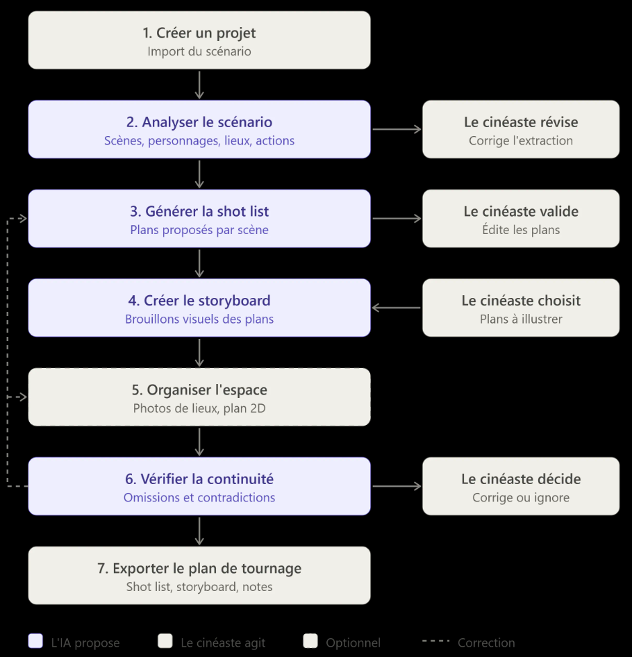

# Parcours du cinéaste

| Étape | Qui agit | Ce qui se passe | Route de l'API | État |
| --- | --- | --- | --- | --- |
| 1. Créer un projet | Cinéaste | Crée le projet et importe le scénario | POST /api/projects, POST …/screenplay | Implémenté (texte) ; PDF et DOCX prévus |
| 2. Analyser le scénario | IA propose | Extrait scènes, lieux, moments, personnages, actions, dialogues, éléments visuels ; le cinéaste corrige | PATCH …/scenes/{id} | Implémenté en mode démo ; modèle de langage prévu le 21 novembre |
| 3. Générer la shot list | IA propose | Propose des plans par scène ; le cinéaste modifie, ajoute, supprime, approuve | …/shots/suggest, …/shots | Implémenté en mode démo |
| 4. Créer le storyboard | IA propose | Brouillons visuels pour les plans choisis | — | Prévu le 24 novembre |
| 5. Organiser l'espace (optionnel) | Cinéaste | Place acteurs et caméras sur un plan 2D, relie chaque caméra à un plan | PUT …/layout | Données et calcul implémentés ; éditeur visuel prévu |
| 6. Vérifier la continuité | Règles | Signale omissions et contradictions ; le cinéaste corrige ou ignore | GET …/continuity, …/dismiss | Implémenté (7 règles) |
| 7. Exporter le plan de tournage | Cinéaste | Shot list, storyboard et notes en PDF | — | Prévu le 24 novembre |

Une alerte de continuité renvoie le cinéaste à la shot list (étape 3) ou au plan 2D (étape 5), puis la vérification est relancée.

## Démonstration prévue pour le jury

Un seul parcours complet sur une courte scène fictive (`examples/appartement.txt`) :

1. Importer le scénario : Scenora extrait la scène, Maya, Adam, la fenêtre, la lettre et la table.
2. Générer les plans : plan large, plan moyen sur chaque personnage, insert sur la lettre.
3. Générer le storyboard des plans choisis (prévu).
4. Vérifier : placer deux caméras de part et d'autre de l'axe Maya–Adam et voir l'alerte des 180°.
5. Exporter le plan de tournage (prévu).
